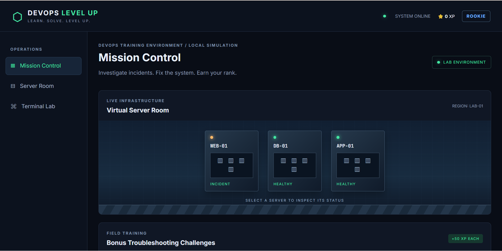
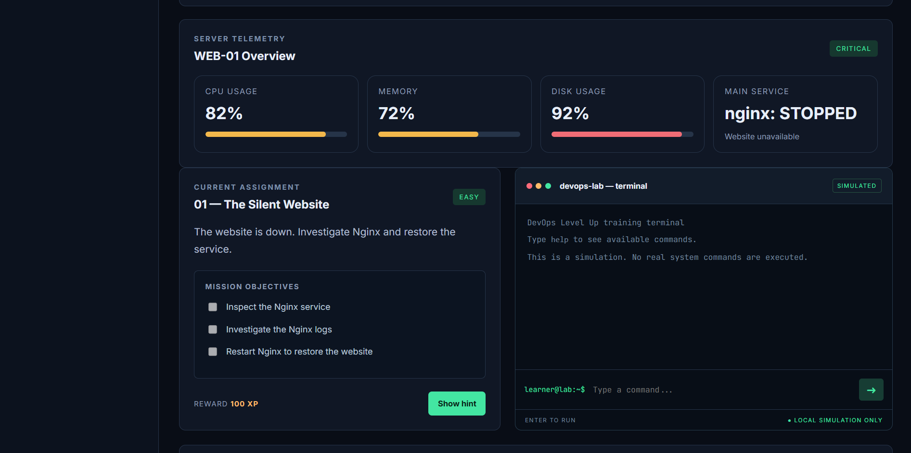
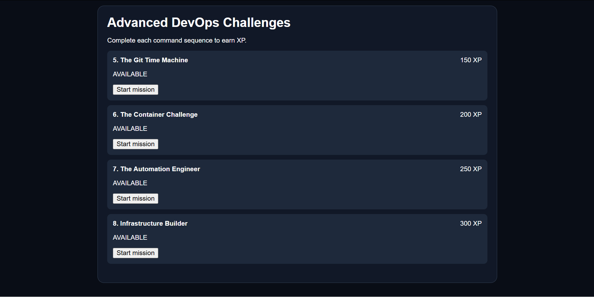

# 🚀 DevOps Level Up

**Learn. Solve. Level Up.**

DevOps Level Up is an interactive, browser-based DevOps training simulator designed to help beginners develop practical knowledge of DevOps concepts through simulated troubleshooting missions and challenges.

## 🎯 Project Overview

The goal of this project is to make learning DevOps more practical, interactive and engaging.

Users investigate simulated server incidents, execute Linux commands, solve infrastructure problems and earn experience points (XP).

## ✨ Features

- Interactive mission control dashboard.
- Virtual server room with simulated server health.
- Simulated Linux terminal.
- Troubleshooting missions and objectives.
- XP rewards and progress tracking.
- Bonus server troubleshooting challenges.
- Git, Docker, Ansible and Terraform practice challenges.
- Browser-based progress saving.

## 🛠️ Technologies Used

- HTML5
- CSS3
- JavaScript
- Git and GitHub
- GitHub Pages

## 📚 Training Areas

1. Linux system administration
2. Bash and command-line operations
3. Git and GitHub
4. Docker fundamentals
5. Ansible automation
6. Terraform and infrastructure as code
7. Server monitoring and troubleshooting

## 🚀 Getting Started

### Run locally

Clone the repository:

```bash
git clone https://github.com/anthonynzedevops-sketch/devops-level-up.git
```

Enter the project directory:

```bash
cd devops-level-up
```

Start a local web server:

```bash
python3 -m http.server 8000
```

Open your browser and visit:

`http://localhost:8000`

## 🌐 Live Demo

[Launch DevOps Level Up](https://anthonynzedevops-sketch.github.io/devops-level-up/)

## ⚠️ Important Note

DevOps Level Up is a learning simulation. Commands entered into its training terminal are simulated and do not execute on real servers or infrastructure.

## 👨‍💻 Author

**anthonynzedevops-sketch**

Aspiring DevOps Engineer.

---

*Learn by doing. Solve real-world-inspired problems. Level up your DevOps skills.*
## 📸 Project Screenshots

### Mission Control


### Terminal Lab


### Advanced DevOps Challenges

